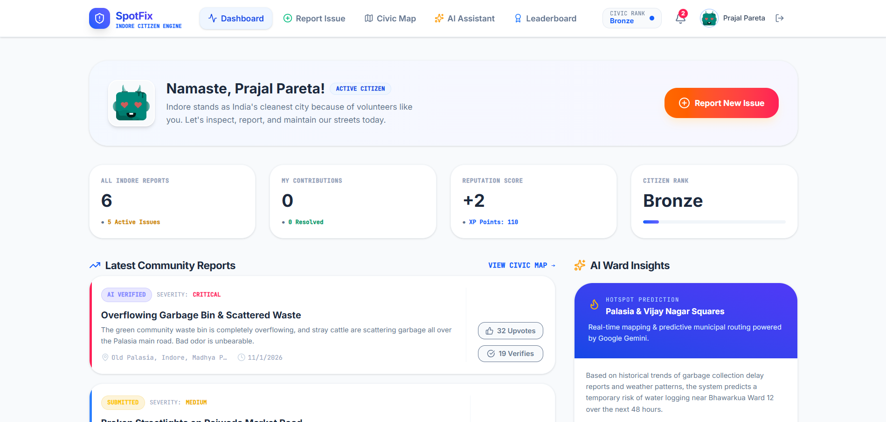
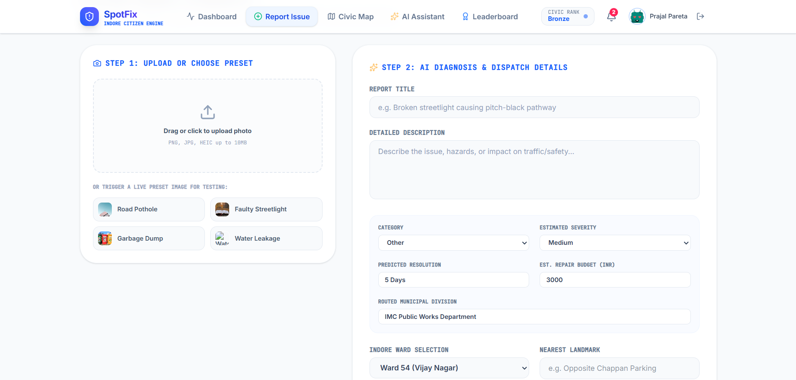

# 🏙️ SpotFix: Indore Citizen Engine

AI-powered civic issue reporting and community problem-solving platform for smarter cities, built around hyperlocal reports for Indore.

🔗 **Live demo:** [spot-fix-one.vercel.app](https://spot-fix-one.vercel.app)


## 📸 Screenshots




## 📌 About

SpotFix lets citizens of Indore report local civic issues, such as potholes, faulty streetlights and waste problems, and follow them until they are resolved.

It was built for a hackathon on Naukri.com, where participants were required to use **Google AI Studio**. The tool builds a complete app from a written prompt and refines it based on follow-up instructions.

**My role:** Wrote the prompts and follow-up instructions, tested the app, iterated on fixes, and deployed it to Vercel.

## ✨ Features

- 📸 Report an issue with a photo, title and description
- 🤖 AI diagnosis and dispatch: suggested category, severity, predicted resolution time, repair budget and municipal department
- 📊 Dashboard with community reports, upvotes and verifications
- 🗺️ Civic map and AI-generated ward insights
- 🏆 Leaderboard with citizen ranks and reputation points
- 👤 Guest Citizen mode to explore the app

## 🧰 Tech Stack

- Google AI Studio (prompt-to-app generation)
- Gemini API
- Firebase (Firestore)
- Deployed on Vercel

## ▶️ Run Locally

**Prerequisites:** Node.js

1. Install dependencies:
   ```bash
   npm install
   ```
2. Create a `.env.local` file and set `GEMINI_API_KEY` to your own Gemini API key.
3. Run the app:
   ```bash
   npm run dev
   ```

## 💡 What I Learned

- Writing clear, specific prompts and giving step-by-step feedback to get the output I wanted
- Testing AI-generated code and spotting what needed fixing
- Deploying a web app to production

## 👤 Author

**Prajal Pareta**
[LinkedIn](https://www.linkedin.com/in/prajal-pareta-881631259) · [GitHub](https://github.com/K-Prajal)
